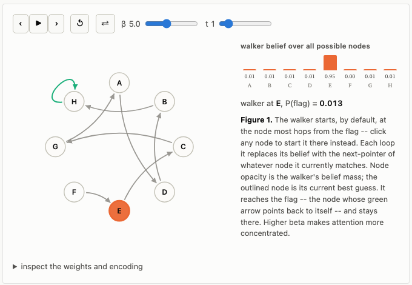
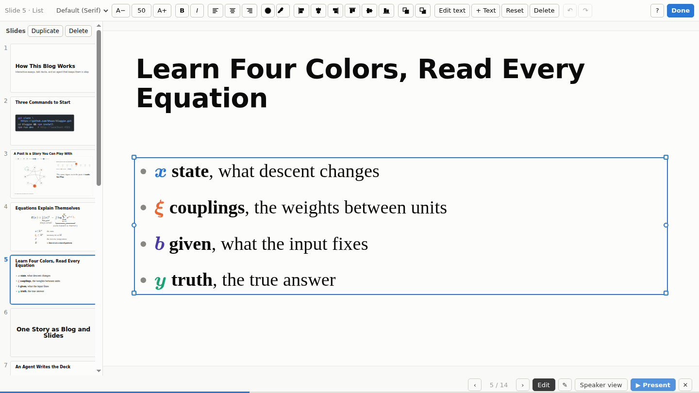

# Bloggie

> Write one story with your AI agent. Publish it as an interactive blog post that ports to slides when you need them.

Bloggie turns one plain-text story into an interactive blog post. When you are ready, an AI agent makes a talk deck
from it that runs the same live figures. Every post downloads as a single HTML file that works offline.

- **One story, two forms.** A post, plus an optional slide deck beside it that reuses its figures and tables.
- **Built to write with an agent.** Everything is plain text, one folder per post. `AGENTS.md` and the build's checks
  tell an AI agent how to draft, build figures and check its own work.
- **You are in control.** The agent's slides may not be the slides you want. Edit them with the mouse in the dev
  server, and each change is written back to the deck's text file.
- **Interactive figures.** Everything is HTML, CSS and JavaScript. Readers play the demos in the post and on the slides.
- **Works offline.** Each post downloads as one HTML file with working figures, and as a text version for AI readers.
- **Easy to host.** A static site, with a workflow that deploys it to GitHub Pages.

## Start

```sh
npx github:bhoov/bloggie my-blog     # copies Bloggie into my-blog/, dates the example post today, installs
cd my-blog && npm run dev            # http://localhost:4321/
```

Or clone it: `git clone https://github.com/bhoov/bloggie.git my-blog && cd my-blog && npm install`.
Use Node 22 or later. Set your title, name and site address in `src/site.js`, and copy
`src/pages/posts/how-this-blog-works/` to `src/pages/posts/<slug>/` to start a post.

## Commands and keys

| Command | What it does |
| --- | --- |
| `npm run dev` | Preview at http://localhost:4321/ while you write |
| `npm run build` | Check symbol colors, links and citations, then build `dist/` and each post's downloads |
| `npm test` | The unit tests, then the end-to-end checks in headless Chromium |

Only under `npm run dev`: each save is drawn in the open page without a reload, E on a deck opens the slide editor,
and a download is built when you click it.

| Key | Where | What it does |
| --- | --- | --- |
| S | post | open its deck |
| T | post | fold or open the table of contents |
| → ← Space, Home End | deck | next and previous slide, first and last |
| F, N, P | deck | full screen, speaker notes, speaker view in a second window |
| Esc | deck | back to the post |
| E | deck, `npm run dev` | the slide editor; its keys follow Figma's (listed at the top of `bloggie/editor/client.js`) |

## How this blog works

This section is the example post, `src/pages/posts/how-this-blog-works/index.mdx`, converted to GitHub Markdown. Run
`npm run dev` to see it with its live figure and its deck.

Each post on this blog is a story told with prose, equations, results and demos the reader can play with. Each post can also become a talk whose slides run the same demos. Everything is plain text, one folder per post, and an agent does the building and the checking. This page shows what you get, and how little it takes to start.

### A post is a story you can play with

A post mixes prose, equations, results and live demos.
A **figure** is a demo the reader drives in the page.
It waits for Play, so the page stays still until the reader asks; Fig. 1 is one.



*Fig. 1* A still of the live figure; run `npm run dev` to play it.

Describe what a figure should show, and an agent builds it, tests its numbers, and checks it in a browser.
A demo that needs seconds of work waits behind a *Load demo* button, so a page never stalls.

Equations are typeset when the site builds, so they appear at once, and they are numbered and linked as in Quarto.
Each one can have braces that name its terms and a legend that names its symbols, as Eq. (1), the self-attention of a transformer, does:

$$
\tag{1}
{\color{#2a78d6}Y} = \underbrace{\operatorname{softmax}\!\left(\frac{{\color{#4a3aa7}X}{\color{#eb6834}W_Q}\,({\color{#4a3aa7}X}{\color{#eb6834}W_K})^\top}{\sqrt{d}}\right)}_{{\text{who attends to whom}}}\;\underbrace{{\color{#4a3aa7}X}{\color{#eb6834}W_V}}_{{\text{what each token sends}}}
$$

- **Shapes:** $N$ tokens of width $D$; queries, keys and values of width $d$.
- ${\color{#4a3aa7}X} \in \mathbb{R}^{N \times D}$: **tokens**, one row per token.
- ${\color{#eb6834}W_Q}, {\color{#eb6834}W_K}, {\color{#eb6834}W_V} \in \mathbb{R}^{D \times d}$: **projections** to queries, keys and values.
- ${\color{#2a78d6}Y} \in \mathbb{R}^{N \times d}$: **output**, each row a weighted average of the values.
- $\sqrt{d}$: keeps the scores near unit scale, so the softmax does not saturate.

A citation is a number in order of first use: hover over [[1]](https://arxiv.org/abs/1706.03762), or tap it, for its source.
The post ends with the numbered References, and the build fails on a key that is not in `src/references.json`.

Every section heading has a faint # that copies a link to it, so a reader can point a colleague at one paragraph.
The sections are listed in the margin of a wide window, with the one you are reading marked; in a narrow window, scroll up a little and a bar at the top names it and opens the list.
Press T to fold the list away or open it.

#### Symbol colors

Every post colors a math symbol by its role, and a role has the same color in every post and every deck.
Each blog names its own roles and their colors in `src/roles.js`; this blog's are:

- ${\color{#4a3aa7}X}$ **input**: what the data fixes.
- ${\color{#eb6834}W}$ **weights**: what training learns.
- ${\color{#2a78d6}Y}$ **output**: what the model computes.

The color says what a symbol does before its legend says what it is, so a reader who learns the colors once reads every equation on the blog faster.
Each post opens with a key under its byline that names the roles the post uses, as this page's does.
A role's name is its TeX macro, `$\given{X}$`, and the build checks that a symbol keeps its color wherever the post and its deck write it, in prose too.

### One Story as Blog and Slides

A post can have a **deck**, a talk version of the post in a `slides.mdx` file beside it.
The deck runs the same live figures, so a demo you build once works on the page and on the projector.
Press S on a post to open its deck, as on [this post's deck](src/pages/posts/how-this-blog-works/slides.mdx).
There, ▶ Present goes full screen, and Speaker view shows your notes, the next slide and a clock in a second window.

**Ask an agent for the deck.**
The `blog-to-slides` skill ships with the blog.
It turns a post into slides with one idea each, text large enough for the back of the room, and full-slide demos.
It checks every slide in a browser, then tells you where the post's story was hard to follow.

**Fine-tune it with the mouse.**
Under `npm run dev`, press E on a deck to turn on the **slide editor**.
Drag, resize and align blocks, change fonts and colors, and edit text in place.
Double-click words to bold or color only those words, and use the column of slides on the left to duplicate or delete a slide.
The keys follow Figma's.
Each change goes straight into `slides.mdx`, so the deck stays a text file, and your edits and an agent's mix freely.
Fig. 2 shows the editor on this post's deck.



*Fig. 2* **Slide editor**, on this post's deck. The selected list shows its handles; the toolbar above sets its font, size, color and alignment, and the column on the left lists the slides.

**Keep post and deck in step.**
When the argument changes in one, ask the agent to carry the change to the other: "Update the deck for the changes to the post."
It keeps the layout you set with the editor.

### One style, written down for your agent

`AGENTS.md`, at the top of the repository, is the blog's style guide and the manual for any coding agent (Claude Code and Codex both read it).
It says how a post is written, how a figure is built and tested, and how a deck looks.
Some of its rules are one sentence per line, an example beside each idea, legends that read like slides, and one color per role.
Add your own rules, and every agent follows them in every post and deck.
The build enforces the mechanical ones—a broken link within a page, an unknown citation, or a symbol without its color stops `npm run build`.

You write the argument; the agent builds and checks what it needs.
Prompts that work:

> Draft a post in `src/pages/posts/<slug>/` from these notes: …
>
> Build a figure for the post that shows …
>
> Read the post as a first-time reader in a browser, use every control, and list what is unclear.
>
> Make slides for the post with the blog-to-slides skill.

### Download for Offline Distribution

The arrow in each post's byline downloads the post as one file, and its menu offers two kinds:

- **Interactive page.** Styles, fonts, images, video, figures and the deck, all inside one HTML file. It opens from disk with a double click and needs no internet, so you can present from a laptop offline, or send the post by email.
- **For agents.** The post as text for a language model, with math as MathML and its TeX source. Each figure becomes a description with traces from its own numbers, and the figures' source code is appended. Give it to another agent as reading material.

### Everything is a plain text file

A post is one folder, and every file in it is text you can open in any editor:

```
src/pages/posts/<slug>/
  index.mdx       the post: Markdown, math and figure tags
  slides.mdx      its deck
  data/  media/   the numbers and pictures it shows
  _experiments/   the Python behind its numbers (optional)
```

Copy this post's folder to start a new one; the home page lists every post, newest first.
Front matter `tags: [wip]` marks a post in progress on the home page, and `tags: [archived]` hides it until the reader asks for it.
Write one sentence per line, so that a diff shows which sentence changed.

**Experiments live with the post.**
A post's Python—its data generators, training runs and tests—sits in its `_experiments/` folder, beside the sentences that report its numbers.
The whole blog shares one Python environment, managed by uv.
A number the post shows is copied into `data/`, with a comment that names the run behind it.
A figure can even run the post's own Python in the reader's browser, through MicroPython.

**Edit by hand.**
Most edits are a line or two, as the table below shows.

**What to write for each element of a post and its deck.**

| To add | Write |
| --- | --- |
| Section | `<h2 id="setup">Setup</h2>` |
| Equation | `$$ … $$`, with `\label{eq-name}` to number it |
| Link to it | `[](#eq-name)`, shown as "Eq. (1)" |
| Symbol color | `$\given{X}$`, one macro per role in `src/roles.js` |
| Citation | `<Cite key="vaswani2017">[Transformer]</Cite>` |
| Figure | its tag, such as `<PointerChase client:visible />` |
| Slide | `## Title` in `slides.mdx` |
| Demo slide | `## [demo] Title`, then a figure's tag |
| Equation slide | `## [equation] Title`, then the equation and its symbols |

Other kinds of slide show a table from the post, a picture of a task, or a full-screen video.
[This post's deck](src/pages/posts/how-this-blog-works/slides.mdx) uses most of them, and `AGENTS.md` lists every rule.

<details>
<summary>The source of this post's deck</summary>

````mdx
---
layout: '@bloggie/layouts/Slides.astro'
title: How This Blog Works (slides)
description: The talk version of "How this blog works"; its source uses each way to write a slide.
---

import PointerChase from '@/figures/pointer-chase/PointerChase.svelte'
import RoleKey from '@bloggie/components/RoleKey.astro'

# How This Blog Works

Interactive essays, talk decks, and an agent that keeps them in step

<Notes>Every slide here is written in the same plain text as the post; the post shows this deck's source.</Notes>

## Two Commands to Start

```sh
npx github:bhoov/bloggie my-blog
cd my-blog && npm run dev
```

<Notes>A static site built with Astro: no server, no database, no account. It redraws on every save. Then set your title and name in src/site.js, and copy this post's folder to start your own.</Notes>

## [demo zoom=1.5 svgMax=390px noteTop=310px] A Post Is a Story You Can Play With

<PointerChase client:visible model="transformer" />

<p slot="note">The same figure as in the post: it **waits for Play**.</p>

<Notes>A figure is a demo the reader drives. Describe what it should show, and an agent builds it, tests its numbers and checks it in a browser. A slow demo waits behind a Load demo button.</Notes>

## [equation eqSize=54] Equations Explain Themselves

$$
\state{Y} = \underbrace{\operatorname{softmax}\!\left(\frac{\given{X}\coupling{W_Q}\,(\given{X}\coupling{W_K})^\top}{\sqrt{d}}\right)}_{\mathclap{\note{who attends to whom}}}\;\underbrace{\given{X}\coupling{W_V}}_{\mathclap{\note{what each token sends}}}
$$

- $\given{X} \in \mathbb{R}^{N \times D}$ the tokens
- $\coupling{W_Q}, \coupling{W_K}, \coupling{W_V}$ the projections
- $\state{Y} \in \mathbb{R}^{N \times d}$ the output
- Each output row is **a weighted average of values**

<Notes>Typeset when the site builds, numbered and linked as in Quarto. Braces name the terms; the legend names the symbols.</Notes>

## Learn the Colors Once, Read Every Equation

<RoleKey />

<Notes>A role has the same color in every post and deck, so the color says what a symbol does before the legend says what it is. Each blog names its roles in src/roles.js, and each post opens with a key of the roles it uses. The build checks that a symbol keeps its color everywhere.</Notes>

# One Story as Blog and Slides

## An Agent Writes the Deck

Ask for **slides for this post** with the blog-to-slides skill, which ships with the blog.

<Notes>It makes one idea per slide, text for the back of the room and full-slide demos, checks every slide in a browser, and then says where the post's story was hard to follow.</Notes>

## [reasons] Fine-Tune It With the Mouse

- **Press E** on a deck, under npm run dev
- **Drag, resize, align** blocks, and edit text in place
- **Every change** is written to the deck's text file

<Notes>Show it live: press E, drag a paragraph, double-click a word and color it. The keys follow Figma's. Because the deck stays a text file, your edits and an agent's mix freely.</Notes>

## Keep Post and Deck in Step

Change the post, then ask the agent to **update the deck**. Your layout stays.

## One Style, Written Down

- **AGENTS.md** is the style guide every agent reads
- One sentence per line, an example beside each idea
- Add your own rules in plain English

<Notes>Claude Code and Codex both read AGENTS.md. The build enforces the mechanical rules: a broken link, an unknown citation, or a symbol without its color stops npm run build.</Notes>

## [reasons] Download for Offline Distribution

- **Interactive page** one HTML file that works offline, deck inside
- **For agents** text, math as TeX, figures described, source code

<Notes>The arrow in the byline, and its menu. Present from a laptop without a network, or hand the post to another agent as reading material.</Notes>

## Everything Is Plain Text

- **index.mdx** the post
- **slides.mdx** its deck
- **data/** and **media/** what it shows
- **_experiments/** the Python behind its numbers

<Notes>The folder is src/pages/posts/ and a slug. Copy a folder to start a new post. One Python environment for the whole blog, managed by uv.</Notes>

## [table] Most Edits Are One Line

<PostTable id="tbl-edits" />

<Slide kind="text" title="Push to Publish">

Push to main, and GitHub Actions **builds and deploys** the site to Pages.

<Notes>A hand-written Slide tag, the form every heading above becomes. Once, set Settings → Pages → Source to GitHub Actions.</Notes>

</Slide>
````

</details>

### Publish

Push to `main`, and GitHub Actions builds the site and publishes it to GitHub Pages.
Once, in the repository's Settings → Pages, set the source to GitHub Actions.
Set the site's address in `src/site.js`, so that a downloaded post links back to it.

#### References

1. Ashish Vaswani et al. [Attention Is All You Need](https://arxiv.org/abs/1706.03762). NeurIPS 2017 (Advances in Neural Information Processing Systems 30); arXiv:1706.03762, 2017.

## Contributing

Bloggie is developed inside a working blog and copied here. To change the engine, open a pull request against
`bloggie/` in this repository.

## License

Apache 2.0. See [LICENSE](LICENSE).
