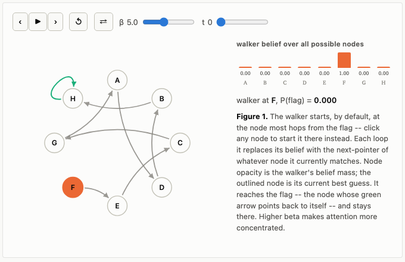
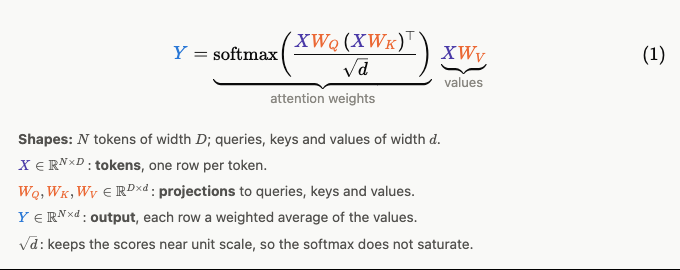

# Bloggie

> Write one story with your AI agent.
> Publish it as an interactive blog post that ports to slides when you need them.

**Live demo:** the example post, https://bhoov.com/bloggie/posts/how-this-blog-works/, and its deck, https://bhoov.com/bloggie/posts/how-this-blog-works/slides/.

Bloggie turns one plain-text story into an interactive blog post.
When you are ready, an AI agent makes a talk deck from it that runs the same live figures.
Every post downloads as a single HTML file that works offline.

- **One story, two forms.**
  A post, plus an optional slide deck beside it that reuses its figures and tables.
- **Built to write with an agent.**
  Everything is plain text, one folder per post.
  `AGENTS.md` and the build's checks tell an AI agent how to draft, build figures and check its own work.
- **You are in control.**
  The agent's slides may not be the slides you want.
  Edit them with the mouse in the dev server, and each change is written back to the deck's text file.
- **Interactive figures.**
  Everything is HTML, CSS and JavaScript.
  Readers play the demos in the post and on the slides.
- **Works offline.**
  Each post downloads as one HTML file with working figures, and as a text version for AI readers.
- **Easy to host.**
  A static site, with a workflow that deploys it to GitHub Pages.

## Start

```sh
npx --allow-git=root github:bhoov/bloggie my-blog     # start a new blog in my-blog/ and install its packages
# npx --allow-git=root github:bhoov/bloggie my-blog --title "My blog" --author "Ada Lovelace"
# OR add metadata later to `src/site.js`
cd my-blog && npm run dev            # http://localhost:4321/
```

`--allow-git=root` lets npm 12 and later fetch Bloggie from GitHub; older npm ignores it.
The new blog is your own git repository; Bloggie, the engine, is its `bloggie/` folder, and `npm run bloggie:update` brings in later versions.

Use Node 22 or later.
See the example post, "How this blog works", for features.
You can copy that post's folder, `src/pages/posts/how-this-blog-works/`, to `src/pages/posts/<slug>/` to start a post.

## Commands and keys

| Command | What it does |
| --- | --- |
| `npm run dev` | Preview at http://localhost:4321/ while you write |
| `npm run build` | Check links and citations, then build `dist/` and each post's downloads |

When developing with `npm run dev`, pressing `e` on a deck opens the slide editor that saves without page reloads, and downloads are prepared on click.

On a post, press `s` to open its deck, or `t` to fold or open the table of contents.
On a deck:

| Key | What it does |
| --- | --- |
| `→` `←` `space` | next, previous slide |
| `home` `end` | first, last slide |
| `f` | full screen |
| `n` | speaker notes |
| `p` | speaker view, in a second window |
| `esc` | back to the post |
| `e` | the slide editor (under `npm run dev`); its keys follow Figma's |

## A post is a story you can play with

A post mixes prose, equations, results and live demos.
A figure is a demo the reader drives in the page; it waits for Play, so the page stays still until the reader asks.



Equations are typeset when the site builds, numbered and linked as in Quarto, with braces that name their terms and a legend that names their symbols.



Citations are managed for you.
Add a source once to `src/references.json` and cite it by its key; the post numbers each citation in order of first use, shows the source on hover, and lists every source at the end.

## One story as blog and slides

A post can have a slide deck, a talk version in a `slides.mdx` file beside it, which runs the same live figures.
Once you are happy with the story of your post, ask an AI agent to generate the deck for you.
The `bloggie-slides` skill ships with the blog, so the agent makes one idea per slide with text large enough for the back of the room, and checks every slide in a browser.
Then fine-tune it with the mouse in the slide editor.
Each change goes into `slides.mdx`, so your edits and an agent's mix freely.
When the post changes, ask the agent to "update the deck for the changes to the post"; it keeps your layout.


## Everything is a plain text file

A post is one folder, and every file in it is text you can open in any editor:

```
src/pages/posts/<slug>/
  index.mdx       the post: Markdown, math and figure tags
  slides.mdx      its deck (optional)
  data/  media/   the numbers and pictures it shows
```

The blog's home page is an index that lists every post, newest first.
You can ask an agent to write a post or its slides, or edit it yourself in Markdown and HTML.

## One style, written down for your agent

`AGENTS.md` is the blog's style guide and the manual for any coding agent (Claude Code and Codex both read it).
Add your own rules, and every agent follows them in every post and deck.
You write the argument; the agent builds and checks what it needs.
For example:

> Draft a post in `src/pages/posts/<slug>/` from these notes: …
>
> Build a figure for the post that shows …
>
> Read the post as a first-time reader in a browser, use every control, and list what is unclear.
>
> Make slides for the post with the bloggie-slides skill.

A note written as `((…))` anywhere in a file asks the agent to address it and remove it (`AGENTS.md` has the rule).

## Download for offline distribution

The  in each post's byline downloads the post as one HTML file, with its styles, figures and deck inside.
It opens from disk with no internet, so you can present from a laptop offline or send the post by email.
The menu beside it also offers the post as text for an AI agent.

## Publish

Push to `main`, and GitHub Actions builds the site and publishes it to GitHub Pages.
Once, in the repository's Settings → Pages, set the source to GitHub Actions.

## Contributing

This repository is the engine, and `template/` is the starter blog that `npx` copies and the demo site shows.
In a blog, the engine is the `bloggie/` folder, kept as a git subtree.
To change it, edit `bloggie/` in your blog and commit, then publish it to a branch of your fork with `node bloggie/scripts/publish.js --remote <your fork> -m "What changed" --yes`, and open a pull request here.
Only the folder's content goes, as one commit with that message; none of your blog's commits do.
To check a change in the starter blog, make one with `node scripts/create.js ../demo --copy-engine` and run `npm run build` there.
`AGENTS.md` has the engine's rules.

## License

Apache 2.0.
See [LICENSE](LICENSE).
